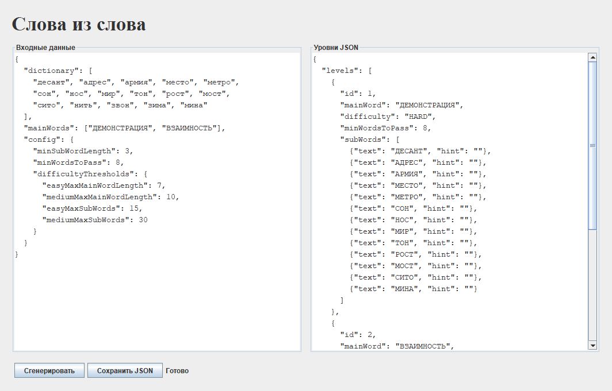

# Слова из слова

Генератор создаёт игровые уровни для русской словесной игры. На вход он получает словарь, список главных слов и настройки. Для каждого главного слова программа находит подслова, определяет сложность уровня и сохраняет результат в JSON. Приложение работает на Java 8 и новее, интерфейс написан на Swing.

## Assignment 1 · Words from Word

Build a Java program that takes a Russian dictionary, a list of main words and a configuration object, and generates game levels in JSON. Each level contains an ID, the main word, a difficulty rating, the number of subwords needed to pass and the list of valid subwords. Each subword has a text field and a hint.

A subword must occur in the dictionary, meet the minimum length and use each letter at most as many times as it appears in the main word. The main word itself is excluded. For example, **БАРАН** fits **БАРАБАН**, while **БАРБАР** needs a second **Р**. Duplicate entries count once. A level is skipped if it has too few subwords.

To run the example with Java 8 or later, use `java -jar Words.jar example.json output.json`. The sample produces two levels: **ДЕМОНСТРАЦИЯ** (HARD) and **ВЗАИМНОСТЬ** (MEDIUM). The input, expected output and a screenshot of the desktop application are included below.

## Как запустить

В Windows дважды щёлкните по **run.bat**. В окне уже будет загружен пример. Измените словарь или главное слово, нажмите **Сгенерировать**, затем **Сохранить JSON**.

Для запуска из командной строки откройте папку проекта и выполните:

```
java -jar Words.jar example.json output.json
```

[Пример входных данных](example.json) · [Ожидаемый результат](levels.json)



## Как формируется уровень

Например, из слова **БАРАБАН** можно составить **БАРАН**. Слово **БАРБАР** не подойдёт: для него нужны две буквы **Р**, а в главном слове только одна.

- Подслово должно быть в словаре, отличаться от главного слова и содержать не меньше `minSubWordLength` букв.
- Генератор убирает пробелы по краям, приводит текст к форме Unicode NFC и переводит слова в верхний регистр. Повторы учитываются один раз, в порядке первого появления. **Е** и **Ё** считаются разными буквами.
- Если найдено меньше `minWordsToPass` подслов, генератор пропускает уровень. При точном совпадении с порогом уровень создаётся. Нумерация уровней начинается с 1.
- Сложность зависит от длины главного слова и количества подслов. Сначала проверяются обе верхние границы для `EASY`, затем для `MEDIUM`. Границы включительные. Остальные уровни получают сложность `HARD`.

## Сборка и проверка

Для сборки понадобится JDK 8 или новее. Выполните команды из папки проекта в Windows:

```bat
mkdir build
javac -encoding UTF-8 -d build src\*.java
jar cfe Words.jar Main -C build . example.json
javac -encoding UTF-8 -cp build -d build tests\GeneratorTest.java
java -cp build GeneratorTest
```

Тесты проверяют кратность букв, исключение главного слова, дубликаты, минимальную длину, регистр и букву Ё. Отдельно проверяются пустой результат, точное совпадение с порогом прохождения, уровни сложности и обработка словаря из 100 001 записи.

## Формат входного файла

Сохраните JSON в UTF-8. Метка BOM в начале файла допустима. Для числовых настроек указывайте целые значения. Если минимальная длина подслова больше длины всех главных слов, совпадений не будет. Кнопка сохранения становится доступной после успешной генерации. Редактирование входных данных сбрасывает результат.

## Ограничения

Качество подслов зависит от словаря: программа не проверяет орфографию и значения слов. Подсказки остаются пустыми. Генератор один раз подсчитывает буквы каждого кандидата, но для каждого главного слова перебирает весь отфильтрованный словарь. Во время обработки большого файла окно может временно перестать отвечать. Такой файл удобно обработать из командной строки.

[Журнал запросов и ответов ИИ по разработке](AI-usage.md)
